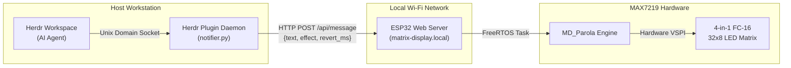

# ESP32 MAX7219 Dot Matrix Display & Herdr AI Agent Notifier

[](https://platformio.org)
[](https://www.espressif.com)
[](https://github.com/gauravssingh/herdr-plugins)
[](https://opensource.org/licenses/MIT)

A smart, connected 32×8 LED matrix display and autonomous digital clock designed for developer desks and AI agent workspaces. It acts as a dedicated physical notification screen for **Herdr** (AI agent workspace manager), showing which agent finished a task or needs attention with glanceable, non-scrolling animations.

---

## 🌟 Highlights

* **Autonomous Hardware Digital Clock (`HH:MM`):** The ESP32's onboard FreeRTOS task runs its own NTP-synchronized real-time clock. It never freezes or depends on the host machine to keep ticking.
* **Glanceable Status Animations:** Uses the hardware-accelerated **MD_Parola** engine to display distinct transitions for different agent states:
  * **Done (`[v]AGY:S3`):** Center-out curtain reveal (`opening`)
  * **Needs Attention (`! AGY:S3 !`):** Drop-down slide from top (`scroll_down`)
  * **Started Working (`> AGY:S3`):** Horizontal wipe from right (`wipe`)
  * **Error (`X AGY:S3`):** Vertical Venetian slats (`blinds`)
* **Hardware Auto-Revert:** Accepts a `revert_ms` countdown parameter so the ESP32 hardware returns to the clock on its own, even if the host machine goes to sleep.
* **Web OTA Updates (`POST /update`):** Flash firmware updates directly over Wi-Fi without ever plugging in a USB cable again.
* **Live Real-time Web Preview:** Embedded web interface polls at 4 Hz to simulate and render the exact physical matrix state in your browser.
* **Self-Healing Network Stack:** Automatic Wi-Fi reconnect watchdog and dynamic last-known IP caching to prevent stale DHCP routing issues.

---

## 📐 Architecture



---

## 🔌 Hardware Wiring

Works with standard ESP32 boards (ESP32-WROOM-32, DevKitC, or WEMOS D1 Mini ESP32) driving a **MAX7219 4-in-1 FC-16 Matrix Module** (32 columns × 8 rows).

| MAX7219 Pin | ESP32 GPIO | Notes |
|:---:|:---:|---|
| **VCC** | **5V / VBUS** | Powers the display LEDs (0.3–0.6A peak) |
| **GND** | **GND** | Shared common ground |
| **DIN** | **GPIO 23** | Hardware VSPI MOSI |
| **CS**  | **GPIO 5**  | Chip Select |
| **CLK** | **GPIO 18** | Hardware VSPI SCLK |

---

## 🚀 Getting Started

### 1. Build and Flash via USB (First Time Only)

Ensure PlatformIO is installed:
```bash
# Build firmware
pio run

# Upload to connected ESP32 via USB
pio run -t upload
```

### 2. Over-The-Air (OTA) Updates (Subsequent Flashes)

Once the initial image is flashed, update wirelessly anytime over Wi-Fi:
```bash
# Build the binary
pio run

# Push over Wi-Fi
curl -F "firmware=@.pio/build/esp32dev/firmware.bin" http://matrix-display.local/update
```

---

## 📡 REST API Reference

The ESP32 runs an HTTP server on port 80.

### `POST /api/message`
Display a message or switch display modes.

| Parameter | Type | Default | Description |
|---|---|---|---|
| `text` | string | — | Text to render (supports `[v]`, `[!]`, UTF-8 `✓`) |
| `effect` | string | `wipe` | Animation: `opening`, `scroll_down`, `wipe`, `blinds`, `slice`, `dissolve`, `print` |
| `align` | string | `center` | `center`, `left`, or `right` |
| `speed` | int | `25` | Frame delay in milliseconds |
| `pause` | int | `3000` | Dwell time at completion (ms) |
| `revert_ms`| int | `0` | Auto-reverts to native clock after N milliseconds |
| `clock` | int/bool | `0` | If `1`, immediately resumes the onboard NTP clock |
| `save` | int | `0` | Set `1` to persist message into flash memory |

### `GET /api/status`
Returns JSON containing active text, current effect, IP, heap, and a 32-column dot matrix buffer array:
```json
{
  "text": "[v]AGY:S3",
  "effect": "opening",
  "align": "center",
  "clockMode": false,
  "ip": "192.168.68.73",
  "dots": [0, 14, 17, 17, 17, 14, 0, ...]
}
```

---

## 🤖 Herdr Plugin Setup

The Herdr plugin lives in [`herdr-plugin/`](./herdr-plugin).

### Link to Herdr
```bash
herdr plugin link ./herdr-plugin
```

### Subcommands
```bash
# Start the background event listener
python3 herdr-plugin/notifier.py start

# Check connection status
python3 herdr-plugin/notifier.py status

# Trigger test animations
python3 herdr-plugin/notifier.py test-done      # Center-out wipe: [v]AGY:S3
python3 herdr-plugin/notifier.py test-blocked   # Slide from top:  ! AGY:S3 !
python3 herdr-plugin/notifier.py test-working   # Slide from right:> AGY:S3
```

---

## 📄 License
MIT License. Created by [Gaurav Singh](https://github.com/gauravssingh).
